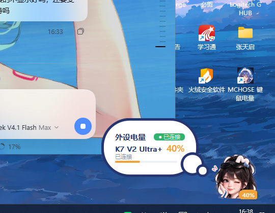

# 桌面外设电量

一个 Windows 桌面小挂件：显示 MCHOSE HUB 与标准 BLE 外设的电量，并提供虚拟形象、云朵电量气泡和托盘驻留。



## 功能

- 桌面透明头像常驻，头像右下角显示首个鼠标/有电量外设的百分比
- 左键单击头像展开 / 收起云朵电量气泡；悬停不展开
- 自动列出 HUB 内全部**当前已连接**且带电量设备（不限 MCHOSE 型号）+ 标准 BLE Battery Service 设备
- 未连接/已断开的设备不会显示
- 右键头像打开圆角设置卡片：大小 50%–300%、开机启动、隐藏、刷新、退出
- 按住头像拖动到桌面任意位置，位置自动保存
- 拖到屏幕边缘（14px 内）松手，自动收进屏幕，只留一个边缘标签；点击标签滑出
- 托盘菜单：显示 / 隐藏、立即刷新、设置、开机启动、退出
- 有线键盘没有电池时显示“不显示电量”，不当作故障
- 支持范围有限：厂商私有协议（罗技 G HUB、雷蛇 Synapse 等）暂不支持，不能宣称所有外设通用

## 依赖

- Windows 10/11
- Python 3.10
- MCHOSE HUB（用于读取电量缓存）

## 本地运行

```powershell
python -m pip install -r requirements.txt
python app.py
```

直接运行源码时，程序会用当前 Python 环境启动。打包后建议通过安装器生成的快捷方式启动，避免黑色控制台窗口。

## 构建 exe

```powershell
python -m pip install -r requirements.txt
pyinstaller --noconfirm --clean MCHOSEBatteryWidget.spec
```

产物在 `dist/MCHOSEBatteryWidget/`。

## 构建安装器

先完成上面的 PyInstaller 构建，然后：

```powershell
python installer_build/build_installer.py
```

脚本会：

1. 把 `dist/MCHOSEBatteryWidget/` 压缩成 `installer_build/payload.zip`
2. 用 .NET Framework 的 `csc.exe` 编译 `installer_build/Installer.cs`
3. 输出 `release/桌面外设电量_安装程序_v1.6.1.exe`

安装器支持自选安装位置，默认安装到：

```text
%LOCALAPPDATA%\Programs\MCHOSEBatteryWidget
```

## 数据来源

电量读取自 MCHOSE HUB 的本地缓存，以及标准 BLE GATT Battery Service：

```text
%APPDATA%\MCHOSEHUB\Local Storage\leveldb
```

MCHOSE 设备需要 HUB 正在运行并已上报电量；标准 BLE 设备需要系统已配对并暴露 Battery Service。

## 卸载

1. 右键托盘图标 → 退出
2. 删除安装目录（默认 `%LOCALAPPDATA%\Programs\MCHOSEBatteryWidget`）
3. 删除桌面 / 开始菜单快捷方式

## 开源与签名

源码使用 MIT License。角色素材的授权说明见 [`assets/README.md`](assets/README.md)。

代码签名计划使用 SignPath Foundation；申请和 GitHub Actions 配置说明见 [`docs/SIGNPATH.md`](docs/SIGNPATH.md)。

## 说明

本项目不是 MCHOSE 官方软件，电量数据来自本机 MCHOSE HUB 缓存；如果 HUB 未运行或设备未上报，电量可能显示为空。
